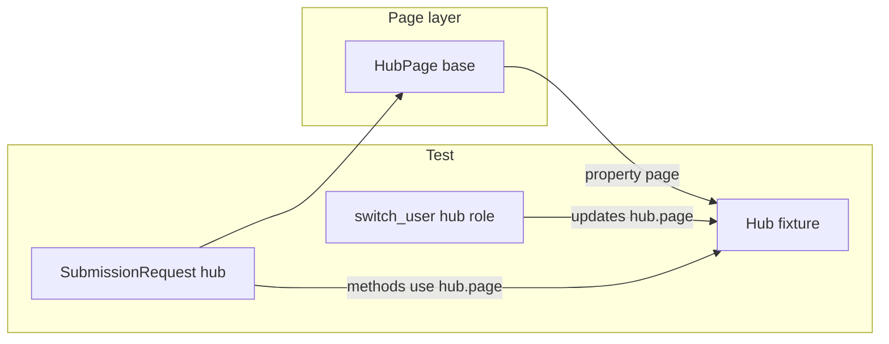

# Hub-backed page objects (framework-wide)

**Status:** Planned — implement after CRDCDH-3948 is merged and green on QA/QA2.

**Goal:** Tests construct `SomePage(hub)` once. `auth.switch_user(hub, role)` only updates `hub.page`; page objects always read the live tab. No re-instantiating page objects after every role change.

---

## Does framework-wide make sense?

**Yes**, with one deliberate exception.

| Benefit | Why it matters for CRDC |
|--------|-------------------------|
| **One convention** | QA and porters never choose between `hub.page` vs `hub`; every live test reads the same way. |
| **`switch_user` safety** | Katalon SR/DS/email suites swap roles many times per script. Caching `Page` in page objects is the bug; binding to `Hub` fixes it once in the page layer. |
| **Small test surface today** | Only ~10 pytest files use `hub.page` under `tests/`; migrating pages + tests in one pass is feasible. |
| **No `hub.foo()` facade** | Tests keep named actors (`sr`, `ds`, `studies`), not session-chaining like `hub.submission_request().inquire(...)`. |

**Exception — auth bootstrap (not tests):** `LoginPage` in `src/crdc_pw/pages/login.py` runs inside `src/crdc_pw/auth.py` **before** a test `Hub` exists. Keep login on `(page, locators)` there only. Tests and all Hub UI pages use **`Hub`**.

**What we are not doing:**

- Adding domain methods to `Hub` (`hub.submission_request()`).
- Changing `switch_user` to reuse the same browser context.
- Reviving a Katalon-style `keywords/` package or `App` facade.

`Hub` stays a thin session (`page`, `locators`, `settings`, `role`). Only page object **constructors** change.



---

## Problem

`switch_user(hub, role)` opens a new browser context, assigns `hub.page`, and **closes the old context**. Any page object built with `SomePage(hub.page, hub.locators)` holds a **stale `Page`**. The next click fails with `TargetClosedError` (seen on CRDCDH-3948 TC03 before post-switch re-instantiation).

Rebuilding `SubmissionRequest(hub.page, …)` after every `switch_user` works but does not scale for DS/SR scripts with many role changes—it is easy to forget and adds noise to tests.

---

## Decision

**Hub-backed page objects (#3):** page classes take `hub: Hub` and resolve `page` / `locators` from `hub` on each use (via `@property`), not from a cached `Page` at construction time.

**Rejected:** Hub facade (#4) — too much `hub.` on every line in tests.

---

## Design

### 1. `HubPage` base

Add in `src/crdc_pw/pages/base.py` (or `hub_page.py` re-exported from base):

- `__init__(self, hub: Hub)` stores `self._hub = hub`
- `@property def page` → `self._hub.page`
- `@property def locators` → `self._hub.locators`
- Existing helpers (`_loc`, `_wait_for_table_settled`, etc.) keep using `self.page`

**Nested pages:** When a list page calls `HeaderPage(...)`, pass the same **`hub`**, not a snapshot of `self.page`.

**Composite keywords:** `SubmissionRequest(hub)` builds `SubmissionRequestFormPage(hub)` and `SubmissionRequestsListPage(hub)` once; all are Hub-backed.

### 2. Page inventory (migrate to `HubPage(hub)`)

| Module | Classes |
|--------|---------|
| `header.py` | `HeaderPage` |
| `studies.py` | `StudiesListPage` |
| `programs.py` | `ProgramsListPage` |
| `release_notes.py` | `ReleaseNotesPage` |
| `users.py` | `ManageUsersPage`, `UserProfilePage`, `PermissionForm` |
| `data_submissions.py` | `DataSubmissionsListPage`, `DataSubmissionDetailPage` |
| SR | `submission_requests_list.py`, `submission_request_form.py`, `submission_request.py` |

**Stay on `(page, locators)`:** `login.py` (auth-only).

### 3. Test patterns (after migration)

**Multi-role (SR TC03/04, future DS):**

```python
sr = SubmissionRequest(hub)
form = SubmissionRequestFormPage(hub)
# ... Submitter leg ...
switch_user(hub, "Fedlead")
sr.inquire_submission_request(study_name)
switch_user(hub, "Submitter")
form.assert_status("IN REVISION")
```

**Single-role / PBAC:**

```python
users = ManageUsersPage(hub)
switch_user(hub, "Fedlead")
profile = UserProfilePage(hub)
profile.open()
```

Replace every `X(hub.page, hub.locators)` in `tests/` with `X(hub)`.

Remove post-switch re-instantiation blocks in CRDCDH-3948 TC03/TC04 once Hub-backed pages land.

---

## Implementation checklist

- [ ] Add `HubPage` in `base.py`; `LoginPage` unchanged for auth
- [ ] Convert all UI page classes in `src/crdc_pw/pages/` to `__init__(hub: Hub)`
- [ ] Fix internal `HeaderPage(...)` and other nested constructions to pass `hub`
- [ ] Update all tests: `X(hub)` instead of `X(hub.page, hub.locators)`
- [ ] Update `docs/onboarding.md` (remove “recreate page objects after switch”)
- [ ] Update `.cursor/rules/crdc-dh-automation-pw.mdc`
- [ ] Update `src/crdc_pw/pages/__init__.py` docstring
- [ ] Optional: link from `ai/crdc/Playwright-Migration-Plan.md`

### Verification

- `pytest tests/unit -m unit`
- Live smoke: TC08 studies, TC09 programs, PBAC TC01, `-k 3948`, DS GC TC08, TC18 roles
- Grep: no `hub.page, hub.locators` in `tests/` (except comments)

---

## Timing and PR strategy

**Start after CRDCDH-3948** is merged/green—do not mix 3948 feature work with this refactor.

**Recommended:** one PR, “Hub-backed page objects (framework-wide)” — pages, tests, docs, cursor rule.

**Related:** [sr-form-section-fill-refactor.md](sr-form-section-fill-refactor.md) — move section filling onto `SubmissionRequestFormPage` and keep `SubmissionRequest` as a thin workflow facade. Can ship in the same PR as hub-backed pages or immediately after.

**Risk if deferred:** new DS/SR ports copy post-switch constructor boilerplate and reintroduce stale-page failures.

---

## Migration checklist (new Katalon ports)

1. Test receives `hub: Hub` from fixture (already logged in).
2. Construct pages with **`PageClass(hub)`** only.
3. Use `switch_user(hub, role)` when the script calls `Login.switchUser`; do **not** rebuild page objects unless you introduce a **new screen type** for that leg (PBAC: `UserProfilePage` after Admin `ManageUsersPage`).
4. Carry IDs (study name, DS name) in test variables or keyword class attributes—not on `Page`.
