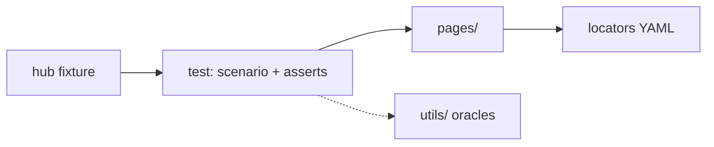

# QA onboarding — CRDC Data Hub Playwright tests

This is the starting point if you are new to **`crdc-dh-automation-pw`**. It covers what this repo is, how it works today, how to set it up and run tests, and what “done” looks like after we leave Katalon.

You do **not** need Katalon Studio installed to run this project. You do need a Hub QA account (or the shared automation accounts) and Python 3.11+.

---

## What this project is

CRDC Data Hub UI automation used to live in **`crdc-dh-automation`**: Katalon Studio, Groovy, Selenium. This repo is the replacement: **Python + pytest + Playwright**.

It is a **behavior-preserving port**, not a rewrite of the product under test:

- Same Hub environments (QA, QA2, Stage)
- Same Login.gov accounts and roles
- Same test intent, case IDs (`TC##_CRDCDH-…`), and input files (Excel / TSV) as we bring suites over
- New engine, locators stored as YAML, tests written as pytest

The sibling Katalon project is still the live suite until we cut over area by area. Do not freeze Katalon globally; a suite moves here when that slice is green.

---

## Where we are vs the end goal

### Today (Phase 0 — scaffold plus first cases)

The framework can:

- Load Hub URL and Login.gov credentials from one YAML file per environment
- Look up locators the same way Katalon did (`CRDC/Login/...`)
- Sign in through Login.gov with TOTP (one-time password)
- Reuse a saved browser session so the next run does not pay OTP every time
- Smoke-test that **Admin, Fedlead, Dcp, Submitter, User, and Master** land on Hub
- Run **TC08** Manage Studies, **TC09** Manage Programs, **TC01** PBAC Fedlead defaults, and **CRDCDH-3974** Release Notes (markdown visible on QA)

That is the floor everything else builds on. Submission Requests, Data Submissions, emails, Mongo, and GraphQL are **not** here yet.

### End goal (after the port)

Replace the Katalon Hub suites with this repo so QA and CI run Playwright instead of Katalon:

| Area (Katalon today) | Rough size | Lands in this repo as |
|---|---:|---|
| Data Submissions | ~79 cases | `tests/` + DS page objects (largest slice) |
| Notification emails | ~27 | UI in Playwright; existing Gmail Python stays |
| Submission Requests | ~19 | SR form + list |
| PBAC | ~19 | First real suite after login |
| Admin / lists / aux | ~16 | Programs, Studies, institutions, dashboard |
| API | ~3 | GraphQL via HTTP, not the browser |

**Cutover rule:** dual-run a suite on QA until it matches Katalon, then retire that Katalon suite. Not a big-bang switch.

Planned order after this scaffold:

1. Remaining **PBAC defaults** (TC02–05) plus isolated PBAC tickets — TC01 is already here
2. **Shared UI kit** — tables, filters, MUI dropdowns, snackbars (unblocks every list page)
3. **Submission Requests**
4. **Data Submissions** (upload, validate, results tables)
5. **Non-browser oracles** — Mongo, GraphQL, CLI uploader, Gmail (`utils/` already holds Excel and GitHub-raw helpers)
6. **Notifications and remaining admin**
7. **CI on GitHub Actions** for smoke + suites; Katalon retired suite by suite

If you are joining during the port, expect new tests to show up as pytest files that still mention the Katalon case name in a comment.

---

## How the framework is laid out

Every live Hub test uses the same pattern:

1. **Fixture** (`hub`) — open the browser, sign in as a role (Login.gov / saved cookies). Same idea as Katalon `closeBrowser` + `loginToCrdcOtp` at the top of every script, except it is not copied into each pytest file.
2. **Page** — one Hub screen. Locators stay in YAML; the page turns those paths into clicks, fills, and reads.
3. **Test** — the *scenario* plus asserts: construct the page, drive it, `expect` / `assert` in the pytest file.
4. **Utils** (optional) — Excel, GitHub raw, TOTP when the case is not page-only. Not the browser.

Initial login is **setup**, not a line in the test. **TC08** (Manage Studies list and filter) is the example below: construct a page, navigate, `expect`, filter, assert. PBAC and DS tests follow the same pattern after the same logged-in `hub`.

If login or the browser fails, follow the plumbing table below. If you want to know *what the case is testing*, read the pytest file.

### Layers



`hub` is who is signed in. The **test** owns the scenario and asserts. A **page** is one Hub screen. **utils** is optional: Excel, GitHub raw markdown, TOTP — not the browser.

### Folders

```
crdc-dh-automation-pw/
├── tests/                  # pytest files (Katalon Test Case / Script)
│   ├── conftest.py         # builds `hub`: browser + login  ← start here if login fails
│   ├── AuxiliaryTests/     # TC08, TC09, TC18, CRDCDH-3974
│   ├── Pbac/               # TC01 Fedlead defaults
│   └── unit/               # no browser (locator, config, sheet, notes helpers)
├── src/crdc_pw/
│   ├── hub.py              # thin session the fixture yields (page, locators, settings, role)
│   ├── auth.py             # Login.gov OTP / Grant (fixture only; tests do not call this)
│   ├── config.py           # which yaml file, which role credentials
│   ├── pages/              # login, header, studies, programs, users, release_notes
│   ├── locators/loader.py  # Katalon path → XPath string
│   └── utils/              # pbac_sheet, static_content, otp
├── locators/CRDC/          # YAML catalog (was Object Repository/*.rs)
├── InputFiles/CRDC/        # PBACPermissions.xlsx (and later TSV / Excel drivers)
├── config/                 # qa / qa2 / stage (was Profiles/*.glbl)
├── auth/                   # saved Login.gov cookies (gitignored)
├── reports/                # HTML + failure screenshots (gitignored)
└── docs/onboarding.md
```

| If you used this in Katalon | Look here instead |
|---|---|
| `Test Cases/CRDC/AuxiliaryTests/TC08_ManageStudiesListAndFilter` | `tests/AuxiliaryTests/test_TC08_ManageStudiesListAndFilter.py` |
| `Scripts/CRDC/.../Script….groovy` | `tests/<Area>/test_TC##_….py` |
| `WebUI.closeBrowser()` + `loginToCrdcOtp` at the top of every script | `tests/conftest.py` (`hub` fixture) |
| `CustomKeywords.'utilities.Login.loginToCrdcOtp'` | `src/crdc_pw/auth.py` (called by the fixture, not the test) |
| `findTestObject` + `WebUI.click` inside that Groovy | `src/crdc_pw/pages/` (`LoginPage`, `HeaderPage`, list pages) |
| `PythonFiles/CRDC/GenerateOtp.py` | `src/crdc_pw/utils/otp.py` |
| Data File `CRDC/Pbac/Permissions` | `InputFiles/CRDC/PBACPermissions.xlsx` + `utils/pbac_sheet.py` |
| Object Repository `CRDC/Login/...` | `locators/CRDC/**/*.yaml` + `LocatorLoader` |
| `Profiles/CRDC_QA.glbl` / `GlobalVariable` | `config/qa.yaml` |
| Test Suite `CRDC_Smoke.ts` | `pytest -m smoke` |

### Fixture, page, test (no keyword layer)

Katalon had **no separate page layer**. `Login.groovy` was both the journey (`loginToCrdcOtp`) and the clicks (`findTestObject`, `setText`, `click`). This repo splits that Groovy class into a **fixture** (session) and **page objects** (screens). There is no `keywords/` package.

| | **Fixture** (`hub`) | **Page** (`pages/`) | **Utils** (`utils/`) | **Test** (`tests/`) |
|---|---|---|---|---|
| Question it answers | Who is signed in, on which tab? | What can you do *on this screen*? | How does Hub compare to a file / GitHub / TOTP? | What is the scenario, and did it pass? |
| Example | Login.gov OTP, saved cookies, `hub.role` | `open()`, `apply_filters()`, `markdown_text()` | `write_expected` / `compare_actual`, `published_notes_snippet` | `expect(studies.container).to_be_visible()` |
| Uses | `auth.py` + `LoginPage` / `HeaderPage` | Locator properties → YAML → Playwright | Excel, HTTP GET, `pyotp` | Page objects + optional utils + `expect` / `assert` |
| Test calls it? | Asks for `hub` (already signed in). Uses `auth.switch_user(hub, role)` only when the *scenario* changes user | Yes — `StudiesListPage(hub.page, hub.locators)` | Yes, when the case needs an oracle (TC01, later 3979) | This *is* the test |

Adding a new list case (TC12) does not touch `Hub` or `conftest.py`. You write a page object and a pytest file.

### What `hub` is

`hub` is **not** the Hub website. It is a thin Python object pytest builds **before** your test function runs: **one Chromium tab, already on Hub, already signed in as a role**. Tests construct page objects from it. It has no `studies` / `programs` / `login` / `header` fields.

Katalon equivalent: the moment *after* `navigateToCrdc()` + `loginToCrdcOtp('Admin')`, browser still open. That whole situation is `hub`.

| You write | What it is |
|---|---|
| `hub.page` | The browser tab |
| `hub.role` | `'Admin'`, `'Fedlead'`, … |
| `hub.locators` | Loaded YAML (`LocatorLoader`) — pages use this |
| `hub.settings` | URL + credentials for this run |

If a test only asks for `hub`, the role is **Admin**. A case that needs every role (TC18) parametrizes `hub` with `indirect=True` so each role gets a **new** browser — like Katalon `closeBrowser` between users, except each role is its own pytest result.

### Walkthrough: TC08 Manage Studies

Command: `pytest -m smoke -k TC08`.

**The test file itself** (`tests/AuxiliaryTests/test_TC08_ManageStudiesListAndFilter.py`) assumes `hub` is already signed in as Admin. The file is the scenario: open the list, check chrome, filter, assert rows.

```python
def test_TC08_ManageStudiesListAndFilter(hub: Hub) -> None:
    studies = StudiesListPage(hub.page, hub.locators)
    studies.open()
    expect(studies.container).to_be_visible()
    expect(studies.add_study).to_be_visible()
    studies.apply_filters(study_name="autoQA", program="AutoTest-Program")
    assert studies.row_count() >= 1
    assert any("autoQA" in cell for row in studies.read_table_rows() for cell in row)
```

Login already happened. Read **down** this list to see the clicks.

**1. Once per pytest process** — `tests/conftest.py`

- `settings` = `config/qa.yaml` (or whatever `CRDC_PROFILE` is)
- `locators` = `LocatorLoader()` reads every file under `locators/CRDC/` into memory (`"CRDC/Login/Login.gov-Btn"` → XPath). Same job as opening Object Repository.

**2. The `hub` fixture** (session setup, not the scenario)

1. Role defaults to `"Admin"` (TC08 does not parametrize).
2. If `AdminEmail` / `AdminPassword` / `AdminSecret` are blank → skip, not fail.
3. Open a Chromium tab. If `auth/qa/Admin.json` exists, load those cookies (last successful Login.gov).
4. Build `LoginSession(page, locators, settings)` from `auth.py`. That session builds `LoginPage` and `HeaderPage` on the **same** tab.
5. `session.navigate()` → `LoginPage` goes to Hub URL, dismisses the system-use banner if it is there.
6. `session.is_logged_in()` → `HeaderPage` looks for the username button.
   - Visible → cookies still good; skip Login.gov.
   - Not visible → `session.login_otp("Admin")` (Katalon `loginToCrdcOtp`), then save `auth/qa/Admin.json`.
7. `session.ensure_hub_ready()` — dismiss the system-use banner if it paints after the header (cookie reuse often does this).
8. **Now** pytest calls your test function with `Hub(...)`.
9. After the test: close the tab (`WebUI.closeBrowser()`). Failure screenshots go on the HTML report under `reports/`.

**3. Inside `login_otp` (only when cookies were dead)** — `src/crdc_pw/auth.py`

The fixture session is the **story**. It does not contain XPaths. It calls the login **page**:

- `start_login_gov()` — Hub Login button, then Login.gov icon
- `submit_credentials(email, password)` — from the yaml, not the test
- Wait for OTP **or** Grant **or** rare extra pages (Rules of Use, NIH agree)
- If OTP: `totp_now(secret)` from `utils/otp.py`, then `submit_otp(code)`
- If Grant: `click_grant()`
- Then `header.username()` to confirm Hub is up

**4. Inside a page click** — `src/crdc_pw/pages/`

`studies.open()` (the line the **test** calls) goes to `HeaderPage.open_manage_studies()`, then waits for the list container. Tests assert `studies.container`; the page maps that to YAML via `_loc()`:

```
studies.container
    → _loc("CRDC/AILocators/Studies/List/Container")
    → LocatorLoader.get(path)     # YAML → XPath
    → page.locator(xpath)         # Playwright, this tab
    → wait until visible, then read or click
```

The test never sees the XPath or the Katalon path. If a locator is wrong, the failure is usually in a **page** wait, not in the filter asserts.

**5. Back in the test** — already logged in

| Line | What it is doing |
|---|---|
| `StudiesListPage(hub.page, hub.locators)` | Bind the Manage Studies screen to this tab |
| `studies.open()` | User menu → Manage Studies, wait for the list |
| `expect(studies.container)` / `studies.add_study` | List chrome is up |
| `studies.apply_filters(study_name="autoQA", program="AutoTest-Program")` | Same filter values as Katalon |
| `assert` row count / `"autoQA"` in a cell | Fail if the filtered table is empty or off |

The fixture is how we signed in. Tests do not call `login_otp` again. They call `auth.switch_user(hub, role)` only when the *scenario* changes user (PBAC).

```
pytest
  load qa.yaml + all YAML locators          (session)
  open tab (+ maybe auth/qa/Admin.json)
  fixture: auth.LoginSession signs in as Admin
  yield Hub                                 ← test starts here, already on Hub
      TEST: StudiesListPage + expect/assert
  close tab
```

### If something fails, where to look

| Symptom | Open this first |
|---|---|
| Skip: missing AdminEmail | `config/qa.yaml` |
| Never reaches Hub / OTP timeout | `auth.py` then `pages/login.py` |
| Timeout on a button name you recognize | YAML under `locators/CRDC/` for that Katalon path |
| Logged in but username assert fails | `pages/header.py` |
| Timeout on Manage Studies / filters | `pages/studies.py` then YAML under `locators/CRDC/AILocators/Studies/` |
| Timeout on Release Notes / empty markdown | `pages/release_notes.py` then YAML under `locators/CRDC/AILocators/ReleaseNotes/` and Footer |
| PBAC Pass/Fail in Excel | `utils/pbac_sheet.py` and `OutputFiles/PBAC_Defaults_Results.xlsx` |
| “Who even opened the browser?” | `tests/conftest.py` fixture `hub` |

### Other live cases (same pattern)

**TC09** is the Programs twin (`tests/AuxiliaryTests/test_TC09_ManageProgramsListAndFilter.py`): `ProgramsListPage(hub.page, hub.locators).open()`, then filters `AutoTest` / `autoQA`, then at least one row contains `auto`.

**TC18** only asserts that each role landed on Hub (header username, URL is Data Commons, not Login.gov). It parametrizes `hub` across the six roles; there is no list page after login.

**CRDCDH-3974** (`tests/AuxiliaryTests/test_TC_CRDCDH-3974_ReleaseNotesPage.py`): footer → `/release-notes`, markdown visible, error alert hidden, text non-empty. A GitHub static-content compare is sketched in `utils/static_content.py` but not called until CRDCDH-3979.

**TC01** (`tests/Pbac/test_TC01_CRDC-PbacDefaultPermissions-Fedlead.py`) is the **middle** of Katalon TC01 (not `loginToCrdcOtp` / `closeBrowser`). Fixture already signed in as Admin. The page reads checkboxes; `utils/pbac_sheet.py` owns the Excel compare — no `verify_*` on the page:

```python
def test_TC01_CRDC_PbacDefaultPermissions_Fedlead(hub: Hub) -> None:
    users = ManageUsersPage(hub.page, hub.locators)
    users.open()
    users.find_and_edit("Fedlead")
    users.reset_permissions("Fedlead")
    users.find_and_edit("Fedlead")
    users.expand_permission_panels()
    write_expected("Fedlead")
    assert compare_actual("Fedlead", users.read_permission_rows())

    switch_user(hub, "Fedlead")
    profile = UserProfilePage(hub.page, hub.locators)
    profile.open()
    profile.expand_permission_panels()
    write_expected("Fedlead-self")
    assert compare_actual("Fedlead-self", profile.read_permission_rows())
```

`navigate`, `closeBrowser`, viewport, and the first OTP stay in the fixture. Scenario clicks stay in the pytest file as page-object calls — not as raw XPaths.

---

## Environments (QA / QA2 / Stage)

One gitignored YAML file per Hub environment, same idea as a Katalon profile:

| File | Katalon profile | Hub |
|---|---|---|
| `config/qa.yaml` | `CRDC_QA` | https://hub-qa.datacommons.cancer.gov/ |
| `config/qa2.yaml` | `CRDC_QA2` | https://hub-qa2.datacommons.cancer.gov/ |
| `config/stage.yaml` | `CRDC_STAGE` | https://hub-stage.datacommons.cancer.gov/ |

Each file holds **`base_url` plus the six role accounts** (`AdminEmail` / `AdminPassword` / `AdminSecret`, and the same for Fedlead, Dcp, Submitter, User, Master). `*Secret` is the Login.gov TOTP seed, not the six-digit code.

Committed templates (URLs filled, secrets blank):

- `config/qa.yaml.example`
- `config/qa2.yaml.example`
- `config/stage.yaml.example`

**How the framework picks an environment:** the shell variable `CRDC_PROFILE`. Allowed values: `qa`, `qa2`, `stage`. If you do not set it, it defaults to **`qa`**.

```bash
# uses config/qa.yaml
pytest -m smoke

# uses config/qa2.yaml
CRDC_PROFILE=qa2 pytest -m smoke
```

Editing `qa2.yaml` does nothing unless `CRDC_PROFILE=qa2`. There is no pytest `--profile` flag yet.

Do **not** commit `config/qa.yaml` (or qa2/stage). They contain passwords and TOTP seeds.

---

## Setup (first time)

### 1. Prerequisites

- macOS or Linux
- **Python 3.11 or newer** (`python3 --version`)
- Git
- Access to the Hub automation accounts (ask the team for the Katalon profile values, or copy them from `crdc-dh-automation` `Profiles/CRDC_QA.glbl` on a machine that already has them)

Chromium is installed in step 3; you do not need to install Chrome separately.

### 2. Clone and enter the repo

```bash
cd crdc-dh-automation-pw
```

### 3. Virtualenv, package, browser

```bash
python3 -m venv .venv
source .venv/bin/activate
pip install -e .
playwright install chromium
```

Stay in the venv for later commands (`which python` should point at `.venv`).

On Windows (PowerShell): `.venv\Scripts\Activate.ps1` instead of `source .venv/bin/activate`.

### 4. Credentials

```bash
cp config/qa.yaml.example config/qa.yaml
```

Open `config/qa.yaml` and fill Email / Password / Secret for every role you need. Copy from the matching Katalon profile (`CRDC_QA` for qa). Blank roles are **skipped**, not failed.

For QA2 or Stage:

```bash
cp config/qa2.yaml.example config/qa2.yaml
# fill, then:
CRDC_PROFILE=qa2 pytest -m smoke
```

### 5. Confirm unit tests (no Hub, no accounts)

```bash
pytest tests/unit -m unit
```

All of these should pass on a fresh clone, even before you fill `qa.yaml`.

---

## Run tests

Always activate the venv first (`source .venv/bin/activate`).

| What | Command |
|---|---|
| Unit (no browser) | `pytest tests/unit -m unit` |
| Login smoke, all six roles (TC18) | `pytest -m smoke` |
| Same, watch the browser | `pytest -m smoke --headed` |
| One role | `pytest -m smoke -k Admin` |
| TC08 Manage Studies list only | `pytest -m smoke -k TC08` |
| TC09 Manage Programs list only | `pytest -m smoke -k TC09` |
| TC01 PBAC Fedlead defaults | `pytest -m smoke -k TC01` |
| CRDCDH-3974 Release Notes | `pytest -m smoke -k 3974` |
| TC18 file only | `pytest tests/AuxiliaryTests/test_TC18_LoginAllRolesAndSwitchUser.py` |
| Against QA2 | `CRDC_PROFILE=qa2 pytest -m smoke` |

The login smoke is Katalon **TC18_LoginAllRolesAndSwitchUser** at `tests/AuxiliaryTests/test_TC18_LoginAllRolesAndSwitchUser.py`. It checks that each role lands on Hub (username in the header, URL is Data Commons, not Login.gov). The `test_` prefix is required so pytest collects the file; the rest of the name matches Katalon.

Every run writes `reports/report-YYYYMMDD-HHMMSS.html` (gitignored, Katalon-style new file per run). Override with `--html=path`. A failed live test embeds a full-page screenshot in that HTML and writes a PNG under `reports/screenshots/`.

Useful pytest extras:

```bash
pytest -m smoke --headed --slowmo 300   # slow the UI down to watch
pytest tests/unit -m unit -q                         # quieter
```

On failure, Playwright can keep a trace (`--tracing=retain-on-failure` once that is wired in CI). Locally, `--headed` is usually enough to see Login.gov.

---

## Saved sessions (`auth/`)

The first successful Login.gov login for a role writes cookies to:

```
auth/<profile>/<Role>.json
```

Example: `auth/qa/Admin.json`. That folder is gitignored.

The next run loads that file, opens Hub, and checks that the header username is visible. If the Hub session (`connect.sid`) is still valid, OTP is skipped. If it expired, the fixture logs in again and overwrites the file.

If login looks “stuck” on an old user or a bad cookie:

```bash
rm -rf auth/qa
```

Then rerun smoke. You will pay OTP once per role again.

**Do not run two OTP logins for the same account at the same time.** TOTP codes are valid for ~30 seconds; two browsers sharing one secret will collide. Login is meant to be once per role, then reuse `storage_state`.

---

## Porting a Katalon case (later)

When you copy a case over:

- Keep the **TC name** in the module docstring or test name so Xray / ticket mapping still works
- Port the **steps and assertions**, not `WebUI.delay`, JS clicks, or stale-element retries
- Put new locators in YAML under `locators/CRDC/`, not as XPath strings in the test
- Put Hub actions in `pages/`. The pytest file is the Katalon script **after** login: scenario + asserts, not Selenium
- Do not open the browser or call `login_otp` in the test; ask for `hub` (already signed in). Use `auth.switch_user(hub, role)` only when the scenario changes role
- Do not close the browser in the test; the fixture does that

---

## GitHub Actions (CI)

CI is **GitHub Actions**, not Jenkins. The workflow is still `workflow_dispatch` only (not on every PR yet). Default integration branch is **`develop`**.

Because `qa.yaml` is gitignored, a checkout does **not** contain passwords.

- **Unit job:** uses `*.yaml.example` (URLs only). No secrets needed.
- **Smoke job (later):** GitHub Environments named `qa` / `qa2` / `stage` hold the same Katalon secret names. A step runs `python ci/write_profile_yaml.py` to write `config/<profile>.yaml` on the runner, then pytest runs as usual.

Details: [ci/README.md](../ci/README.md).

---

## Troubleshooting

| What you see | Likely cause | What to do |
|---|---|---|
| `SKIPPED` … Missing AdminEmail | `config/qa.yaml` missing or blank | Copy the example and fill secrets |
| Tests hit QA2 by accident | `CRDC_PROFILE` still set in the shell | `echo $CRDC_PROFILE`; unset it or set `qa` |
| Timeout on OTP / Grant | Login.gov or Hub slow; OTP window | Rerun; Grant can take 30s+. Do not start a second login for the same user |
| Username empty / still on login.gov | Session expired or login failed | `rm auth/<profile>/<Role>.json` and rerun `--headed` |
| `Profile config not found` | Typo in `CRDC_PROFILE` | Must be exactly `qa`, `qa2`, or `stage` |
| Unit tests fail on locators | Incomplete clone | `locators/CRDC/` must be present |
| `playwright` / browser missing | Step 3 skipped | `pip install -e .` then `playwright install chromium` |
| Wrong Python | venv not active | `source .venv/bin/activate` |

---

## What not to commit

- `config/qa.yaml`, `qa2.yaml`, `stage.yaml`
- `.env` (leftover; this project does not use it anymore)
- `auth/**` session JSON
- `.venv/`

The `*.yaml.example` files **are** committed (no secrets).

---

## Where to look next

| Topic | Place |
|---|---|
| This onboarding | `docs/onboarding.md` |
| Short project README | `README.md` |
| CI / GitHub secrets | `ci/README.md` |
| Migration plan (phases, what to port vs drop) | `ai/crdc/Playwright-Migration-Plan.md` in the sibling `ai` tree |
| Katalon source of truth (until cutover) | `crdc-dh-automation` |
| Object repository YAML | `locators/CRDC/` |

Questions about accounts or which environment to use for a given ticket: ask the QA lead before pointing tests at Stage.
