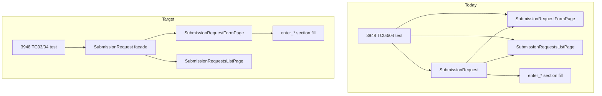

# Submission Request layering: section fill on form, thin workflow facade

**Status:** Planned — implement after [CRDCDH-3948](https://github.com/CBIIT/crdc-dh-automation-pw/pull/16) is merged and green on QA/QA2. Can be combined with or done immediately after [hub-backed-page-objects.md](hub-backed-page-objects.md).

**Goal:** One clear split between **screens** (list + form) and **workflows** (multi-role, multi-screen). Section A–D Excel-driven filling lives on the **form page**; `SubmissionRequest` stays a small Katalon-keyword-style facade that orchestrates list + form only.

---

## Problem today

Three modules overlap in naming and responsibility:

| Module | Intended role | What also lives there today |
|--------|---------------|-----------------------------|
| [`submission_requests_list.py`](../src/crdc_pw/pages/submission_requests_list.py) | SR **list** screen | Correct scope. |
| [`submission_request_form.py`](../src/crdc_pw/pages/submission_request_form.py) | SR **questionnaire** chrome | Save/import, progress bar, a few Section A edits (`set_pi_address`). |
| [`submission_request.py`](../src/crdc_pw/pages/submission_request.py) | Unclear (sounds like a page) | ~250 lines of **section filling**, Excel locators, `_fill` / dropdown helpers, **`fill_submission_request_all_sections`**, plus thin wrappers (`click_submit_button` → `form`). |

Tests such as TC03/TC04 construct **`SubmissionRequest` + `SubmissionRequestFormPage` + `SubmissionRequestsListPage`**, and re-create `sr` and `form` after every `switch_user`, even though `sr` already holds `sr.form` and `sr.list`.

Katalon maps this to one Groovy class (`utilities.SubmissionRequest`); Playwright should map it to **form (UI + sections) + list (table) + facade (workflows)**, not three competing “pages.”



---

## Target architecture

### 1. `SubmissionRequestsListPage` — unchanged scope

List navigation, filters, row actions (View/Resume/Review/Reopen), `open_submission_request_form_for_study`, `reopen_approved_submission_request`.

No section filling.

### 2. `SubmissionRequestFormPage` — form chrome **+** section filling

**Keep (already here):** status bar, Save/Next/Submit, import/export, snackbar asserts, progress bar (A/D/Review), inquire/approve dialogs, message constants (3948, 3952), `set_pi_address` / `set_primary_contact_position`.

**Move from `submission_request.py`:**

- Private helpers: `_fill`, `_fill_if_empty`, `_click_dd_option` (or rename to `_fill_field` on `BasePage` if reused later).
- Module-level section locator constants (`_A_*`, `_B_*`, `_C_*`, `_D_*`, `_DD_VALUE`, `_TOGGLE`).
- `_stamp()` / study-program uniqueness suffix (or move to `submission_request_excel.py` as `unique_suffix()`).
- Public methods (same names as Katalon keywords for porters):
  - `enter_principal_investigator_info`
  - `enter_primary_contact_info`
  - `enter_program_info`
  - `enter_study_info`
  - `enter_funding_agency_info`
  - `enter_data_access_type_and_dbgap_reg_info`
  - `enter_cancer_type_and_subjects_info`
  - `enter_target_delivery_and_expected_publication_date`
  - `select_data_types`
  - `select_file_types`
  - `fill_submission_request_all_sections` (orchestrates save/next between sections using **self**)

**Session state** (today on `SubmissionRequest` class):

- `last_entered_study_title`
- `last_entered_study_abbreviation`
- `last_entered_program_name`

Move to **`SubmissionRequestFormPage`** as class attributes, set in `enter_study_info` / `enter_program_info` (same behavior as Katalon `lastEnteredStudyTitle`).

**File size:** If `submission_request_form.py` exceeds ~450 lines, extract section methods to [`submission_request_form_sections.py`](../src/crdc_pw/pages/submission_request_form_sections.py) as a **mixin** `SubmissionRequestSectionFillMixin` inherited by `SubmissionRequestFormPage` — one import surface for tests, two files for maintainers.

**Overlap with existing form methods:** `set_pi_address` and `enter_principal_investigator_info` both touch PI address; keep both — TC01 uses the short setter; TC02+ use Excel-driven `enter_*`. Optionally implement `set_pi_address` as a thin wrapper later; not required for this refactor.

### 3. `SubmissionRequest` — thin workflow facade only

Rename in docstrings to **“workflow facade”** (optional file rename to `submission_request_workflows.py` is **not** required; keep path for imports/Katalon parity).

**Keep:**

```python
class SubmissionRequest:
    def __init__(self, hub_or_page, locators=None):  # Hub after hub-backed migration
        self.form = SubmissionRequestFormPage(...)
        self.list = SubmissionRequestsListPage(...)

    def inquire_submission_request(self, study_name, comment=None): ...
    def approve_submission_request(self, study_name, comment=None): ...
    def reopen_approved_submission_request(self, study_name): ...
    def open_submission_request_form_for_study(self, study_name, list_status=None): ...
    def _open_submission_request_review(self, study_name): ...
```

**Delegate one-liners (no duplicate logic):**

```python
def fill_submission_request_all_sections(self, ...):
    self.form.fill_submission_request_all_sections(...)

def click_submit_button(self):
    self.form.click_submit_button()
```

**Backward compatibility (one release):**

```python
@property
def last_entered_study_title(self):
    return SubmissionRequestFormPage.last_entered_study_title
# same for abbreviation / program — or class-level aliases on SubmissionRequest:
last_entered_study_title = property(...)  # tests use SubmissionRequest.last_entered_study_title today
```

Prefer updating tests to `SubmissionRequestFormPage.last_entered_study_title` or `sr.form.last_entered_study_title` and then removing aliases.

**Remove from facade:** all `_loc`, `_fill`, section constants, and `enter_*` implementations.

Expected size: **~80–120 lines** in `submission_request.py`.

---

## Test patterns (after refactor)

**Simple (TC01, 3952):** list + form only — no facade.

```python
sr_list = SubmissionRequestsListPage(hub)
form = SubmissionRequestFormPage(hub)
```

**Workflow (TC02–TC04):** one facade; assertions on `sr.form`.

```python
sr = SubmissionRequest(hub)
sr_list = sr.list  # optional; or sr.list.open() only via sr

sr.list.start_new_submission_request()  # or sr_list if test prefers explicit list
sr.form.fill_submission_request_all_sections(...)
study_name = sr.form.last_entered_study_title

switch_user(hub, "Fedlead")
sr.inquire_submission_request(study_name)  # same sr instance after hub-backed pages

switch_user(hub, "Submitter")
sr.open_submission_request_form_for_study(study_name)
sr.form.assert_status("IN REVISION")
```

Remove duplicate `form = SubmissionRequestFormPage(...)` and `sr = SubmissionRequest(...)` blocks after each switch once [hub-backed-page-objects.md](hub-backed-page-objects.md) is done.

---

## Implementation checklist

- [ ] Move section locator constants and `_fill*` / `_click_dd_option` into `submission_request_form.py` (or mixin module).
- [ ] Move all `enter_*`, `select_*`, `fill_submission_request_all_sections` onto `SubmissionRequestFormPage`.
- [ ] Move `last_entered_*` class state to `SubmissionRequestFormPage`; add temporary aliases on `SubmissionRequest` if needed.
- [ ] Shrink `SubmissionRequest` to workflow methods + delegating wrappers only.
- [ ] Update TC02–TC04: use `sr.form` for fill and asserts; drop redundant `form`/`sr` re-instantiation where hub-backed pages allow.
- [ ] Update [`pages/__init__.py`](../src/crdc_pw/pages/__init__.py) module docstring to describe list / form / facade.
- [ ] Update [onboarding.md](onboarding.md) “which page when” table (below).
- [ ] No change to Katalon repo required; Playwright structure becomes clearer for new SR ports.

### Verification

- `pytest tests/unit -m unit`
- `pytest -m CRDC_SubmissionRequests -k 3948` on QA2
- Grep: no `enter_principal_investigator_info` on `SubmissionRequest` class body (only delegates)
- Grep: section constants only under `submission_request_form*.py`

---

## Order relative to other planned work

| Work | Relationship |
|------|----------------|
| **Hub-backed pages** | Do **before or together** with this refactor so TC03/04 don’t need post-switch re-instantiation; facade holds one `hub` reference. |
| **3952 / future SR tests** | Use list + form for UI-only checks; use facade only when filling all sections or Fed Lead flows. |
| **Migrating legacy Section D locators to AILocators** | Independent; can replace `_D_*` paths in form section code when UI YAML catches up. |

---

## “Which class do I use?” (for onboarding)

| Need | Use |
|------|-----|
| Open SR list, filter, Reopen/Review/View row | `SubmissionRequestsListPage` |
| Save, import/export, status, tooltips, progress bar, inquire/approve **dialog** | `SubmissionRequestFormPage` |
| Fill Section A–D from Excel, full submit path | `SubmissionRequestFormPage.fill_submission_request_all_sections` (or `enter_*`) |
| Fed Lead inquire/approve, reopen approved SR, open form by study after multi-role flow | `SubmissionRequest` facade |
| Study title created during fill (for filters) | `SubmissionRequestFormPage.last_entered_study_title` |

---

## Non-goals

- Merging list and form into one class.
- Putting workflow methods on `Hub`.
- Replacing Excel-driven fill with hard-coded TC data (stay 1:1 with Katalon `SubmissionRequest.xlsx` sheets).
- Renaming `SubmissionRequest` to match Katalon file name in this pass (optional follow-up).
