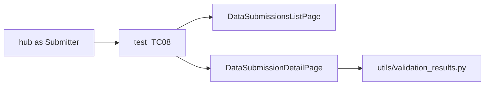

# Port TC08 invalid-integer Data Submission (and the reusable VR skeleton)

Implemented. Katalon source: `Scripts/CRDC/DataSubmissions/GC/CRDCDH-686-Partial/TC08_CRDC-VerifyInvalidIntegerValue` plus `DataSubmissions.groovy` (`createDataSubmission`, `uploadFolder`, `clickValidateButton`, `verifyValidationResultsVsExpectedForTC`).

Keep **compare/upload/create logic 1:1**. Replace `WebUI.delay`, JS overlay hacks, and Selenium stale retries with Playwright waits. Do **not** port `ValidationReport`.

## Test (Katalon script after login)

New file: `tests/DataSubmissions/GC/test_TC08_CRDC-VerifyInvalidIntegerValue.py`

- Marker: `CRDC_DataValidation` (this case lives in Katalon `CRDC_DataValidation.ts`, not Smoke).
- Fixture: `@pytest.mark.parametrize("hub", ["Submitter"], indirect=True)`.
- Body matches Katalon after login (TC09 is the same calls with `"TC09"`):

1. Open Data Submissions (header `DataSubmissions-Tab`).
2. `create_data_submission("New", "metadata only", "GC", "autoQA - AutomationQA_Study")` — same args as Katalon. Name `auto-test_yyyyMMdd_HHmmss`. Filter list by that name, require **exactly one** row, click `CRDC/DataSubmissions/DataSubmissionName-Link` (`//a[contains(@href,'/upload-activity')]`), parse submission id from URL (log only; TC08 does not need Mongo).
3. `upload_folder("TC08")` — all `*.tsv` **directly** in `InputFiles/CRDC/MetadataData/TC08/` (not `expected-ValidationResults/`). Playwright `set_input_files` on `ChooseFiles-Btn`, then Upload. Wait until `Uploading-Text` is gone (Katalon 60s).
4. `click_validate()` — wait enabled, click, wait `disabled` **cleared** for up to **5 minutes** (`VALIDATE_MS = 300_000` on the detail page, not `DEFAULT_MS`).
5. `verify_validation_results_vs_expected_for_tc("TC08", model="GC")` — fail the test if mismatches. Empty expected folder logs and returns (Katalon skip).

Do not click Validate type Both (TC08 is metadata only). Do not delete the leftover DS (Katalon leaves `auto-test_*`).

Prerequisite: Submitter can create a DS (Katalon suite runs EnableAll first). If create is missing, that is PBAC, not this test.

## Pages (Hub actions only)

**Header:** `open_data_submissions()` using `CRDC/AILocators/Global/Header/Desktop/DataSubmissions-Tab`.

**`DataSubmissionsListPage`** (`pages/data_submissions.py` or split list/detail if the file gets large):

- `open()`, `create_data_submission(sub_type, data_type, model, study)` — New/Update vs Delete radios, Metadata Only vs Metadata and Data Files, Data Commons option by **exact inner text** (`GC`), Study option by **whitespace-normalized** text (`autoQA - AutomationQA_Study`). Use YAML (`CRDC/DataSubmissions/Create/*` and AILocators CreateDialog where the old YAML is missing `Create-Btn` / `SubmissionName-TxtBx`). Playwright `fill` for the name field instead of Selenium Actions. Do **not** port JS `MuiBackdrop` removal unless a live run proves the dropdown click is blocked.
- After Create: same as `captureAndLogDataSubmissionIdFromList` (filter `SubmissionName-TxtBx`, one row, open link).

**`DataSubmissionDetailPage`:**

- `upload_folder(tc_name)`
- `click_validate()`
- `verify_validation_results_vs_expected_for_tc(tc_name, model)` — Katalon `verifyValidationResultsVsExpectedForTC`
- VR helpers: click Validation Results tab + aggregated/expanded switch (`ValidationResults_AggregatedExpanded-Btn`), `apply_vr_filters(node, severity, issue_type)` (node `datafile` → `data file` like Katalon), `read_vr_rows()` → `[submitted_id, issue_type, severity]`.

Waits: loading icon hidden (`CRDC/DataSubmissions/Loading-Icon`) instead of `delay(1)`; table settle via existing `_wait_for_table_settled` / fingerprint instead of 0.5s count loops; cell text **1:1 with `getCellText`**: if visible text length `<= 15` use it; else `truncated-text-wrapper` `aria-label`, else first `span` aria-label/text. Add `DataSubmissionName-Link` to `locators/CRDC/DataSubmissions/DataSubmissions.yaml` with the Katalon xpath (it is missing today). Prefer existing Katalon YAML paths the Groovy already uses.

## Oracle (1:1 with Groovy, no report)

New `src/crdc_pw/utils/validation_results.py` — same idea as `pbac_sheet.py`: files and compare, no clicks.

Copy into the Playwright repo:

- `InputFiles/CRDC/MetadataData/TC08/` (upload TSVs + `expected-ValidationResults/`)
- `InputFiles/CRDC/DataSubmissionValidation/DSV_ValidationResults-mappings.xlsx`

Port these functions **with the same rules** (unit-test them):

| Katalon | Rule |
|---|---|
| `nodeFromFilename` | strip `.tsv`, strip `_vX.Y.Z`, then text after first `_` |
| `nodeFromExpectedValidationResultsFilename` | must end `_expected-ValidationResults.tsv`; same version/prefix strip |
| `listTsvFilesAndNodesForTC` | only top-level `*.tsv` in the TC folder |
| `loadValidationResultsMappings` | Excel sheet **GC / ICDC / CTDC / PSDC**. Katalon infers sheet from the test path; pass `model` from the test (`GC`) so we do not depend on pytest nodeid |
| `loadExpectedValidationResultsTsv` | columns: mapping’s submitted-id header, `Issue_Type`, `Expected_Severity`; filter exact issue type + case-insensitive severity |
| `getUniqueSeverityIssueTypePairsFromExpectedTsv` | unique `(Expected_Severity, Issue_Type)` pairs, skip blanks |
| `verifyValidationResultsVsExpected` | match on submitted id; if duplicate ids, prefer the UI row whose issue type equals the filter; missing UI id = fail; extra UI id = fail; issue **exact**; severity **case-insensitive** |

`verifyValidationResultsVsExpectedForTC`: for each node in the expected folder, for each severity/issue pair, filter UI + compare. Mismatches: log each line, then one `assert` with the count (Katalon `markFailed`).

## Unit tests

`tests/unit/test_validation_results.py` (`@pytest.mark.unit`): filename → node; load mappings sheet GC has `diagnosis`; load TC08 expected rows for Error / `Invalid integer value`; compare Pass on equal lists; Fail on missing id, extra id, issue mismatch.

## Docs / out of scope

Onboarding: `tests/DataSubmissions/GC/`, `pytest -m CRDC_DataValidation`, Submitter hub, copy of TC08 inputs.

Out of scope: See details (TC04), data files / Both (TC19), 887 upload-error modal, Cross Validation, Mongo, CLI, leftover-DS delete, EnableAllPermissions (separate doc), ValidationReport.
